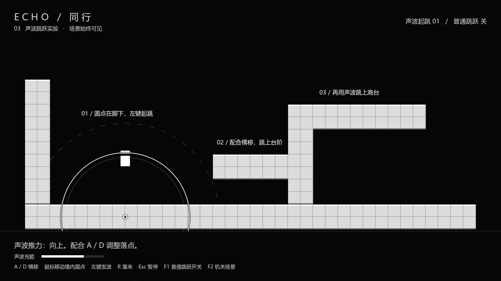
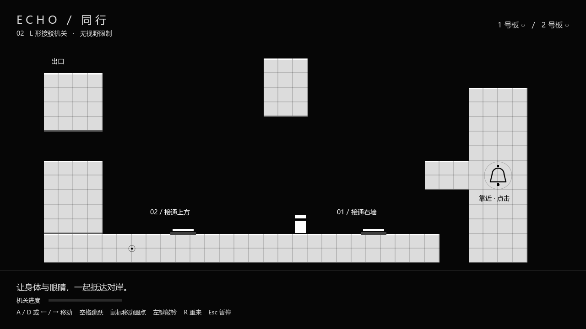

# ECHO / 同行 · Godot 白盒

**当前优先测试声波跳跃。** 场景始终可见，玩家用 A / D 横移；鼠标控制墙内的小圆点，点击产生有限范围的声波，从下方把玩家推离地面，配合空中横移跳上台阶。也能测试向下、向左、向右的推力，以及撞墙反弹。

Godot **4.7.2 标准版 + GDScript**，无第三方插件，无需 .NET。完整工程入口为根目录 `project.godot`。项目根据当前讨论新建，未导入 WorkBuddy 原 demo 源码。

## 立即运行

- 本机双击根目录 **`开始试玩.cmd`**。
- 或在 Godot 中导入 **`project.godot`**，等待首次导入后按 **F5**。
- 单击游戏画面或按 Enter 开始；按 Esc 暂停并释放鼠标。

Windows 启动器会检查 `GODOT_EXE` 环境变量、系统命令和桌面的 Godot 快捷方式。其他机器找不到引擎时，直接在 Godot 中导入工程。



## 当前操作

| 输入 | 功能 |
|---|---|
| A / D 或左右方向键 | 身体横移，空中也可控制方向 |
| 移动鼠标 | 移动墙体内部的感知圆点 |
| 鼠标左键 | 从圆点处发出声波 |
| F1 | 开关普通空格跳跃，用于对比手感；默认关闭 |
| R | 重置身体、圆点与当前声波 |
| Esc | 暂停并释放鼠标 |
| F2 | 在跳跃实验和 L 形机关之间切换 |

## 如何验证跳跃

1. 开始后，圆点已经位于身体脚下的地面内部。直接按左键即可向上起跳。
2. 身体靠近第一层台阶前，在脚下发波；起跳后配合 D 向右移动，落到台阶上。
3. 将圆点从地面沿中间墙体移入第一层台阶，再从脚下发波，跳上第二层高台。
4. 把圆点放到身体的上方、左侧或右侧，可验证相反方向的推力。虚线圈表示声波最大范围。
5. 用 A / D 撞击左墙或中间墙体，可观察反作用力和撞击波纹。

声波按时间向外传播，每一波最多推同一玩家一次，范围外不受力。发波有短暂冷却。普通按键跳跃默认关闭；F1 开启后可用空格、W 或上方向键对比普通跳跃手感。

## 保留的 L 形机关

按 F2 进入，或在编辑器中运行 `scenes/levels/l_relay_puzzle.tscn`：

1. 身体踩住 1 号板，接通右墙入口。
2. 圆点从底部进入右墙，在铃铛旁点击。
3. 圆点进入向左移动的平台，上方另一个平台随后下落。
4. 圆点及时向上转移到下落平台；同时身体赶到 2 号板。
5. 保持踩住 2 号板，将圆点通过连桥送进左上出口。

铃铛触发后 1 号通道保持接通，2 号板则需要持续踩住。当前版本地图和身体都可见，没有视野外死亡。L 形机关暂时使用普通跳跃；声波推力先在独立测试场验证，后续可接入机关。



## 工程结构与调参

| 文件 / 目录 | 用途 |
|---|---|
| `scenes/main.tscn` | 默认入口：声波跳跃测试 |
| `scenes/levels/wave_jump_lab.tscn` | 地面、两层高台和撞墙测试区域 |
| `scripts/wave_jump_lab.gd` | 声波范围、强度、冷却与测试状态 |
| `scripts/force_pulse.gd` | 波前传播、距离衰减、四向推力和单次命中 |
| `scripts/player.gd` | 移动、起跳、空中控制、落地与反作用力 |
| `scripts/eye.gd` | 墙内圆点、鼠标灵敏度与禁止跨空隙传送 |
| `scenes/levels/l_relay_puzzle.tscn` | 保留的 L 形机关地图 |
| `scripts/l_relay_puzzle.gd` | 两个压力板、铃铛与平台接驳流程 |
| `scenes/actors/` | 独立的身体、圆点、平台、压力板等复用场景 |
| `assets/tiles/` | 32×32 黑白白盒瓦片 |
| `docs/当前测试需求.md` | 当前需求与完成状态 |

平台大小在 Inspector 调节 `tiles_wide`、`tiles_high`，编辑器会实时生成瓦片。声波测试的 `pulse_range`、`pulse_strength`、`pulse_cooldown`，以及身体的速度、重力、跳跃高度、冲量衰减、反弹比例均可调。

## 检查

用实际 Godot 引擎运行，无外部测试框架。将 `godot` 替换为本机引擎路径：

```powershell
godot --headless --path . --script res://tests/wave_jump_checks.gd
godot --path . --script res://tests/wave_jump_visual_checks.gd
godot --headless --path . --script res://tests/puzzle_checks.gd
```

分别检查声波起跳、四向推力、有限范围、单次命中、碰撞与连续登台；实际渲染；以及完整 L 形机关流程。早期移动平台与回声观察实验保留在 `first_crossing.tscn`，默认入口不再使用该观察机制。

## 协作与原型范围

远程仓库：<https://github.com/wolfstarlyla0310-ArCatene/NGJ>

本仓库包含可直接导入的白盒工程。功能单独建分支，通过 Pull Request 检查后合并；尽量分别修改独立场景，详见 [CONTRIBUTING.md](CONTRIBUTING.md)。保留 `.uid` 文件，`.godot/` 缓存和导出产物已排除。

本版重点验证玩法和手感，尚未加入实际音频、正式美术、敌人攻击或存档。声波力采用游戏化径向冲量计算，尚未模拟真实声学中的材质、遮挡和多次反射。
